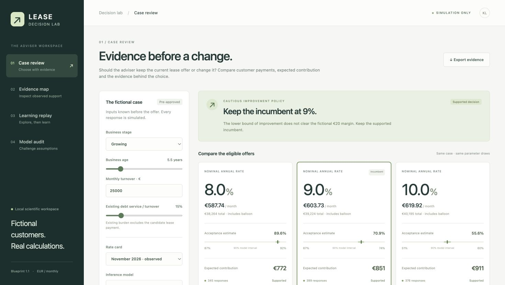

# Lease · Decision Lab

**Keep the current lease offer, change it, or ask for more evidence?**

A local decision prototype by Krystof. It connects customer payments, expected contribution and the evidence behind a recommendation. Customers, pre-approval, responses and economics are authored fiction.

In the saved **Growing + Exact Beta** case, moving from 9% to 10% adds about **€60 in mean expected contribution**. The fifth percentile of that improvement (q05) is about **−€27**: roughly 5% of shared model draws give a lower improvement. Because this is below the fictional €20 switching margin, the cautious rule **keeps 9%**. A new December rate card recalculates payments but requires review because observed support is missing.



[One-minute walkthrough](docs/WALKTHROUGH.md) · [Results and limits](docs/RESULTS.md) · [Architecture](docs/ARCHITECTURE.md)

## Open the saved lab

With Python 3.12, [uv](https://docs.astral.sh/uv/getting-started/installation/) and Make installed, get the source with Git and start the lab:

```sh
git clone https://github.com/krystofmincev/finlease.git
cd finlease
uv sync --frozen
make serve
```

Alternatively, download the [repository](https://github.com/krystofmincev/finlease) ZIP, extract it and run the final two commands from its root.

Open [127.0.0.1:43187](http://127.0.0.1:43187). Stop with Ctrl-C. The saved JSON results and compiled UI are included; this path does no fitting and needs no model weights or Node installation. Initial dependency installation uses the network. See [setup, checks and full reproduction](docs/SETUP.md).

## What to inspect

- **Case review:** compare mean and cautious decisions using shared model draws; see payments and support separately.
- **Evidence map:** inspect 8/10 versus 800/1000 responses and cells with no exposure.
- **Learning replay:** step through saved decisions, pending feedback and the cost of exploration.
- **Model audit:** compare logistic regression, sklearn histogram gradient boosting and pretrained TabPFN V2 on two synthetic worlds; inspect label budgets, real development curves, accuracy checks, known limitations and experiments that were not adopted.

The final point comparison scores **900 applicants per world**, including all **17 unsupported cases**. Same-512-fitting-label controls share full-fit preprocessing/support history; external pretraining is unequalized. Selected models use additional development labels. Point predictions do not supply the lab's cautious or Thompson uncertainty draws.

The implementation handoff passed **72 Python tests**, generated API contracts, TypeScript and actual browser/export checks. The [verification record](docs/VERIFICATION.md) distinguishes that evidence from packaging checks. These results establish a local demonstration, not real-customer accuracy or commercial uplift.

Built with PriorLabs-TabPFN. [Methods](docs/METHODS.md) · [Repository boundary and licences](docs/PUBLICATION.md). No project reuse licence has been selected; third-party notices remain applicable.
