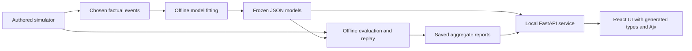

# From factual evidence to a decision

Python owns payments, inference and choices. React/TypeScript renders validated API results. Fitting and replay generation are explicit offline commands.

The learner receives only the chosen response after its availability time. Hidden probabilities and unchosen outcomes stay with the offline evaluator. Tests traverse imports to check that learners and serving cannot load simulation, evaluation or offline builders. This is a data/code boundary, not filesystem secrecy.

Serving loads strict JSON and computes Beta/Laplace decisions; it does not fit models, generate replays or import Torch. The pretrained point benchmark contributes a source/cohort/freeze-matched JSON sidecar. It cannot enter cautious or Thompson adapters. Public reports contain explicitly named aggregate simulator scores, not per-applicant hidden truth.

Pydantic defines requests and reports. OpenAPI generates the TypeScript types and Ajv schemas. Consumers reject unknown fields, missing provenance and mismatched source identities. The service binds to 127.0.0.1:43187 and serves the retained compiled UI.

| Question | Entry point |
| --- | --- |
| How are payments rounded? | [domain/finance.py](../src/lease_lab/domain/finance.py) |
| When does advice change or defer? | [decisions/policy.py](../src/lease_lab/decisions/policy.py), [support.py](../src/lease_lab/decisions/support.py) |
| How is the approximate posterior checked? | [models/logistic_laplace.py](../src/lease_lab/models/logistic_laplace.py), [evaluation/references.py](../src/lease_lab/evaluation/references.py) |
| How do point-model development and labels work? | [evaluation/point_models.py](../src/lease_lab/evaluation/point_models.py), [cohorts.py](../src/lease_lab/evaluation/cohorts.py) |
| What crosses the API? | [contracts.py](../src/lease_lab/contracts.py), [report_contracts.py](../src/lease_lab/report_contracts.py), [api/app.py](../src/lease_lab/api/app.py) |
| Where does the case render? | [CaseReview.tsx](../ui/src/features/CaseReview.tsx) |

Routes: `GET /api/meta`, `POST /api/decision`, `GET /api/report`, `GET /api/replays`, `GET /api/challenger`. The current completed comparison requires its saved challenger sidecar. Missing sidecars are incomplete evidence, even though an unfinished run can still expose other routes.

No runtime LLM, RAG assistant, hosted model or vector store is implemented. A future explanation layer could retrieve versioned methods and call the authoritative decision API; it would still need separate evaluation and authorization.

Built with PriorLabs-TabPFN.
